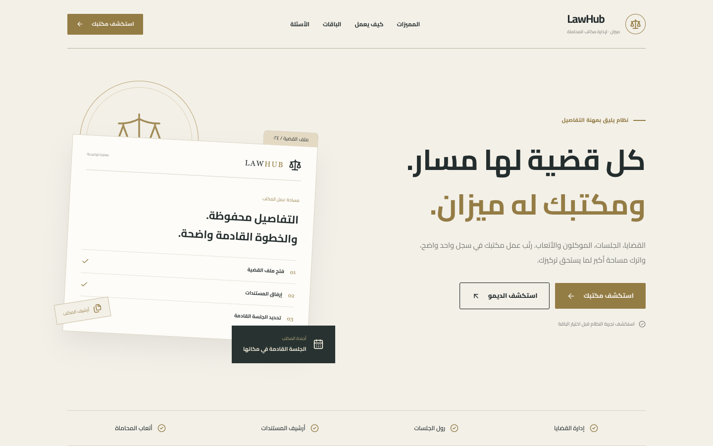
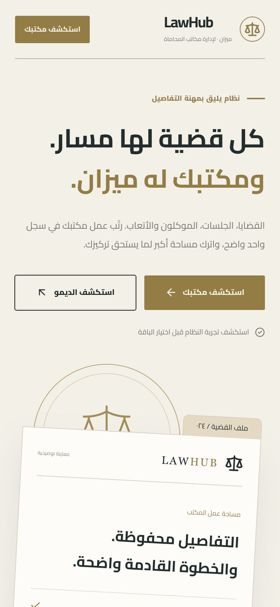
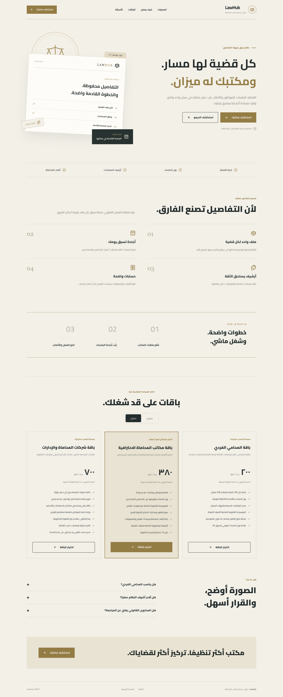

# LawHub (ميزان)

> Cloud platform for law firms: cases, clients and a legal knowledge base.

**Live:** [lawhub.virvib.com](https://lawhub.virvib.com/) · **Role:** Founder & developer · **Period:** 2026 · **For:** Own product

   

## Overview

Law firms manage cases and clients, publish a public portal and use an AI legal assistant.

## What it does

- Case and client management
- AI legal assistant
- Public law-firm portal with templates and testimonials
- Leads inbox

## Engineering highlights

- Laravel API + React dashboard
- Automated deploys

## Screenshots (live site)

  

Full home page

---

Source code is private (client / commercial project). This repository documents the work only.

Built by **Ahmed Gamal** — Senior Laravel Developer · [LinkedIn](https://www.linkedin.com/in/wzcoder/) · [GitHub](https://github.com/ahmed-gamal-dev)
